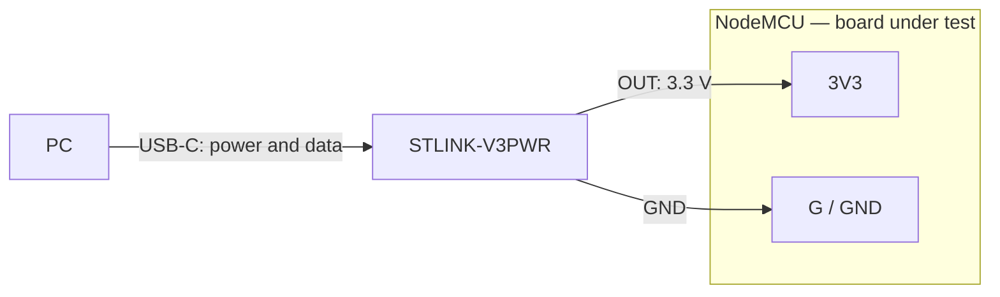

# STLINK power measurements

Measure board current with **STLINK-V3PWR** and save raw samples for analysis. Generate current traces, estimate energy, and compare repeated measurements using mean ± SD.

[](results/deep_sleep_5s_flash_all_20261117_190910_277967/comparison_eng.svg)

## Quick Start

### 1. Install

Python 3.10+; run these commands from the repository root in PowerShell:

```powershell
py -m venv .venv
.\.venv\Scripts\python.exe -m pip install -e .
.\.venv\Scripts\Activate.ps1
```

The editable install provides `stlink-measure` in the activated environment and uses the code in this checkout. The command works from any directory; relative paths such as `results/` are resolved from the current working directory.

### 2. Connect



For the default **3.3 V** supply, use NodeMCU's **3V3** pin. **VIN** feeds the onboard voltage regulator and is a different supply input.

- Flash a [NodeMCU sketch](firmware/nodemcu_led_cycles/README.md), with STLINK output wiring disconnected.
- Disconnect the board's USB. Connect STLINK **OUT → 3V3** and **GND → GND**; the default supply is **3.3 V**. For timed ESP8266 deep-sleep wakeup, also connect **D0 → RST**.
- Close STM32CubeMonitor-Power and any terminal using the meter. Identify its **SMU** port:

```powershell
stlink-measure ports
```

### 3. Capture and analyze

Replace `COM18` with the SMU port and match `--name` / `--notes` to your board and firmware:

```powershell
stlink-measure capture --port COM18 --name no_code --notes "NodeMCU V3; Core 3.1.2; CPU 80 MHz; 00_no_code; USB disconnected" --repeats 10 --seconds 100 --hz 1000
```

Results are saved in `results/<name>_<timestamp>/`. To regenerate reports, use the directory printed after capture:

```powershell
stlink-measure analyze --root results/no_code_20261114_183000_123456
```

## Detailed documentation

- [Measurement methodology and calibration](docs/methodology.md)
- [Output file formats](docs/outputs.md)
- [Interpreting the plots](docs/interpretation.md)

Firmware and results: [idle scenarios](firmware/nodemcu_nocode_cycles/README.md) · [LED cycles](firmware/nodemcu_led_cycles/README.md).

Automation: [upload and measurement sequence](automation/README.md) · [scripts running during acquisition](automation/controllers/README.md).

## FAQ

**How can I open the HIL desktop interface?**

Install the optional GUI with `python -m pip install -e ".[gui]"`, then run `stlink-gui`. The [frontend](automation/frontend/README.md) supports StandAlone captures and native file selection. Use `stlink-gui --demo` for simulated operation.

**How can I run custom actions during a STLINK measurement?**

Use `--controller` to run a Python script alongside each capture. See the [controller README](automation/controllers/README.md).

**How can I automate firmware uploads and switch between boards for measurement?**

Use `stlink-hil --config automation/HIL/config.local.jsonc` for batch measurements or `arduino-upload nodemcu COM22 path/to/sketch.ino` for an upload. See [automation](automation/README.md) for configuration, USB hub control and relay switching.

## Citation

Record the commit used for your measurements when citing the repository.

```bibtex
@misc{panasiuk2026stlink,
  author       = {Panasiuk, Damian},
  title        = {{STLINK} Power Measurements},
  year         = {2026},
  howpublished = {GitHub repository},
  url          = {https://github.com/GHRik/stlink_experiment}
}
```

[MIT license](LICENSE.txt) · Damian Panasiuk
