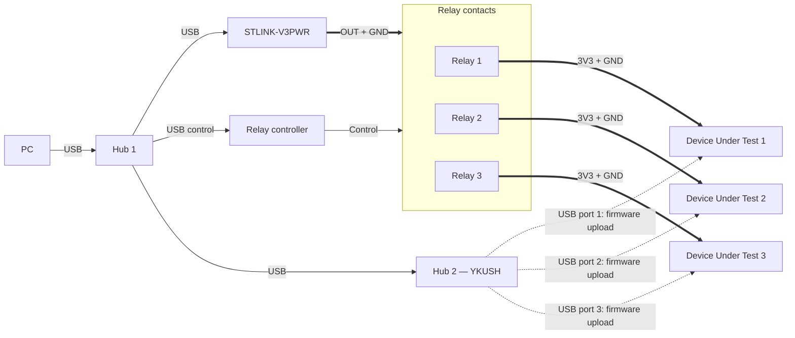

# Sequential upload and measurement



Dashed lines: USB firmware upload. Thick lines: measurement supply and return. Each relay branch switches both OUT and GND, requiring two contacts per DUT. Relay labels 1–3 identify physical branches; configuration channels are zero-based. Hub 1 keeps the meter and relay controller connected while Hub 2 switches the DUT USB connections.

Flash 1–3 ESP8266 boards through YKUSH, then measure each board through a separate relay channel (Numato or LCUS-2). The existing STLINK capture script is unchanged. USB hub and relay drivers are selected independently.

## Configure

Copy [config.example.jsonc](config.example.jsonc) to `config.local.jsonc` in this directory and edit. Each section groups one device or task; fields are described directly in the file using full-line `//` comments. Inline comments, block comments and trailing commas are not supported.

| Setting | Meaning |
| --- | --- |
| `hub` | Driver (`ykush` or `ykush3`), executable, serial number and switched USB ports |
| `relay_controller` | Driver (`numato` or `lcus2`), COM port, total channels; Numato also accepts `channel_digits` |
| `stlink` | SMU COM and acquisition settings under `measurement` |
| `upload` | Arduino CLI executable and upload timeout |
| `timing` | Inter-step delay and board COM enumeration timeout |
| `connected_boards` | List of 1–3 boards; list length is the connected-board count |
| `connected_boards[].upload_profile` | Per-board profile name from `board_profiles.json`, e.g. `nodemcu` |
| `connected_boards[].sketch` | Per-board .ino path, relative to the config file; each board may use a different sketch |

Three settings need distinguishing:

- `hub.driver`: `"ykush3"` uses `ykushcmd ykush3 -s SERIAL ...`; `"ykush"` uses `ykushcmd ykush -s SERIAL ...`. For older CLI builds, only the `"ykush"` driver accepts `model_argument: ""` to omit the subcommand. State verification checks both the physical port number and ON/OFF.
- `relay_controller.channel_digits`: number formatting only: `1` sends channel `0`, `2` sends `00`, `3` sends `000`. It is not the relay count; use `1` for the standard 4-channel USB relay module.
- `stlink.measurement.off_seconds`: STLINK OUT power-off time after calibration and before each repeat. At `1`, the meter waits one second with OUT off, then starts acquisition with automatic OUT power-on. USB/relay switching delays are configured separately under `timing`.

Each board defines its own `upload_profile` and maps `ykush_usb_port` (**1–3**) to an upload `com` and a physical `relay` channel (**zero-based**). Names, USB ports, board COM ports and relay assignments must be unique. Example: three boards use relays 0, 1, 2 while relay 3 is still disabled at startup and cleanup. Replace example COM ports with actual values; the script cannot infer the physical mapping.

The `nodemcu` profile in [board_profiles.json](board_profiles.json) selects NodeMCU 1.0, 80 MHz, full flash erase and 115200 baud upload. Add profiles to this JSON file; the automation configuration only selects a profile. Profiles remain in `automation/HIL/board_profiles.json` and are resolved from the package location, independently of the working directory. The shared uploader is [backend/upload.py](../backend/upload.py). Install **ESP8266 Core 3.1.2** in Arduino CLI before running; the script does not install packages. `ESP.deepSleep(0)` sleeps indefinitely until reset or a power cycle; no periodic wakeup is configured.

### Find board profiles

List installed core packages:

```powershell
arduino-cli core list
```

List connected boards and their COM ports:

```powershell
arduino-cli board list
```

Find the FQBN for a profile among boards supported by installed packages:

```powershell
arduino-cli board listall | Select-String "pico"
```

Use the FQBN as the value in `board_profiles.json`; configure the COM port separately for each board.

## Run

From the repository root:

```powershell
.\.venv\Scripts\python.exe -m pip install -e .
.\.venv\Scripts\Activate.ps1
stlink-hil --config automation/HIL/config.local.jsonc --dry-run
stlink-hil --config automation/HIL/config.local.jsonc
```

Sequence (2 s delay after each switching/upload/measurement step):

1. Switch off **every relay channel**. Numato verifies readback; LCUS-2 accepts successful write and flush as completion.
2. Switch off configured YKUSH ports, verifying states with `-g` through the selected hub driver.
3. For each board: USB on → wait for upload COM → compile/upload using `upload.py` → USB off.
4. For each board: relay on → run STLINK capture → relay off.
5. On completion, failure or Ctrl+C: attempt to switch off all configured relays and USB ports. Cleanup failures are reported.

Only one board is connected to STLINK OUT during measurement. Use **normally open** relay contacts to disconnect each board's OUT supply during USB upload. Keep the hub and relay controller available independently of the switched downstream ports. With VBUS-only YKUSH models, data lines remain connected: this script does not provide additional USB isolation.

The selected relay stays on throughout the existing STLINK procedure, including warm-up, calibration and all repeats. The existing capture code power-cycles OUT before each repeat. Results include board consumption and any remaining USB-related load.

Results: `results/automation_<timestamp>/` contains the configuration snapshot, `events.jsonl`, per-board upload/measurement logs, and standard STLINK sessions under `measurements/`. `--out` changes the parent directory. Arduino/upload failures stop the batch; external processes have timeouts and their process trees are terminated before cleanup.

## Standalone upload

```powershell
arduino-upload nodemcu COM22 automation/HIL/example/example.ino
```

This command only compiles/uploads; it does not switch USB, relays or meter power. The last argument is a local `.ino` path or sketch directory, not an HTTP URL. Pass `--cli "C:\path\to\arduino-cli.exe"` if Arduino CLI is not on PATH, or set `ARDUINO_CLI`. Compiler and uploader output is passed through unchanged with verbose logging and the original CLI exit code. Batch runs save this output in each board's upload log. No Python wrapper library is required.

## Relay driver

Select the device in `relay_controller`:

```json
"relay_controller": {
  "driver": "lcus2",
  "port": "COM22",
  "channels": 2
}
```

For Numato, use `"driver": "numato"`, the actual channel count and `"channel_digits": 1`. The old `numato` configuration section is still accepted.

[config.lcus2.json](config.lcus2.json) is a complete single-board example. Set its actual COM ports and YKUSH serial number before running. Each board's `relay` selects **one** physical channel, numbered from zero. LCUS-2 converts 0/1 to device addresses 1/2. Channels are switched sequentially, with the configured delay after each operation.

LCUS-2 uses 9600 baud and four-byte binary commands. A complete serial write followed by flush counts as completion; no state query is sent. The event log records the requested state, channel and command bytes with `confirmation: write_and_flush`. Numato uses 19200 baud, ASCII commands and state readback.

Both implementations inherit [Relay](../backend/relays.py), exposing `open()`, `set(channel, enabled)` and `close()`. Adding another model requires a driver and a factory entry; the measurement sequence stays unchanged.

## Protocol references

- [YKUSH Windows commands](https://www.yepkit.com/learn/hookup-guide-ykush-windows): serial selection is **`-s SERIAL`**, e.g. `ykushcmd -s SERIAL -d 1`.
- [Current YKUSH CLI syntax](https://github.com/Yepkit/ykush/blob/master/doc/reference-manual-ykushcmd/ykushcmd-reference-ykush.html): model subcommand where required, e.g. `ykushcmd ykush -s SERIAL -d 1`.
- [Numato 4-channel USB powered relay manual](https://productdata.numato.com/assets/downloads/usbrelay/usbpoweredrelay4/UsbPoweredRelay4UserManualV9.pdf): `relay on/off/read`, channels 0–3.
- [Arduino CLI compile](https://docs.arduino.cc/arduino-cli/commands-reference/arduino-cli_compile): `--upload` and verbose compiler/uploader output.

## Hub driver

**YKUSH XS** uses `"driver": "ykushxs"` and `"ports": [1]`. It has one downstream port. The existing board mapping still uses `ykush_usb_port: 1`, but its CLI commands omit the port argument:

```powershell
ykushcmd ykushxs -l
ykushcmd ykushxs -s SERIAL -u
ykushcmd ykushxs -s SERIAL -d
ykushcmd ykushxs -s SERIAL -g
```

See the [YKUSH XS setup guide](https://www.yepkit.com/learn/setup-guide-ykushxs_windows). Multiport XS configurations are rejected before any switching.

For YKUSH3, configure:

```json
"hub": {
  "driver": "ykush3",
  "cmd": "C:\\path\\to\\ykushcmd.exe",
  "serial": "YOUR_HUB_SERIAL",
  "ports": [1, 2, 3]
}
```

`Ykush3` selects the `ykush3` CLI subcommand automatically; no `model_argument` is needed. Both hub drivers inherit [Hub](../backend/hubs.py) with `open()`, `set(port, enabled)` and `close()`. Each switch is followed by a CLI state query; a command error or state mismatch aborts the batch. Port numbers remain 1-based. Existing `ykush` configuration sections are still accepted.

[Official YKUSH3 Windows commands](https://www.yepkit.com/learn/setup-guide-ykush3_windows).
