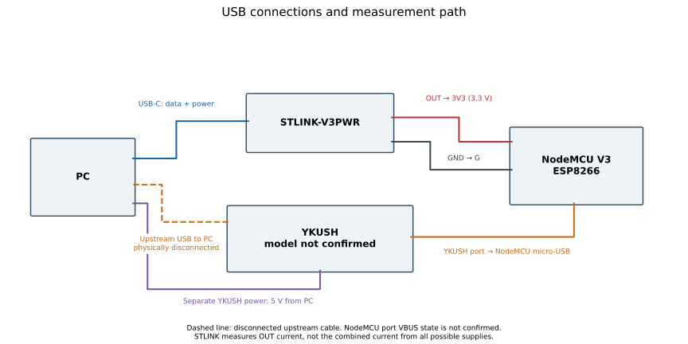
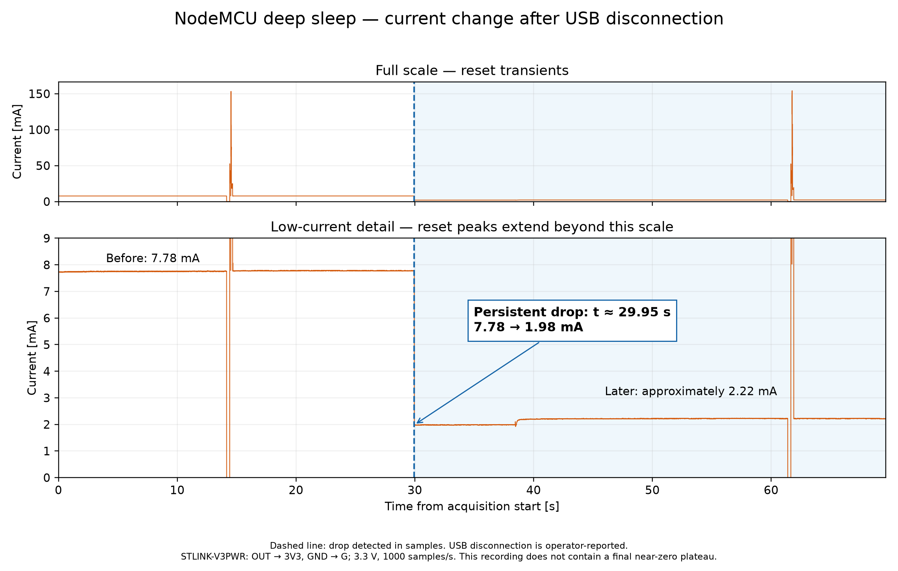
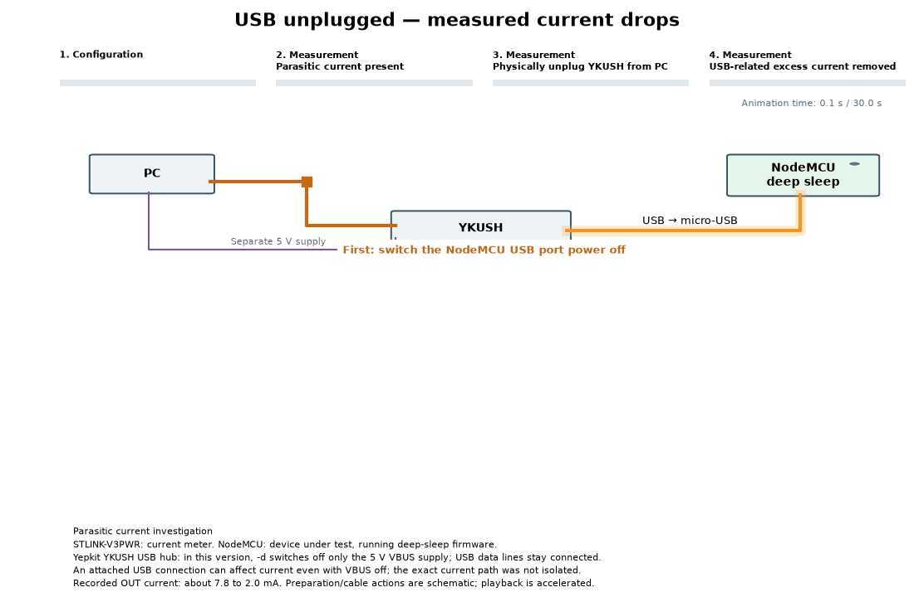

# USB connection and deep-sleep current

Turning off a USB port's power did not fully isolate the NodeMCU. Physically unplugging the YKUSH upstream USB connection reduced the current measured at STLINK OUT from **7.78 mA to 1.98 mA**.

## Setup

- **NodeMCU:** device under test, running deep-sleep firmware.
- **STLINK-V3PWR:** OUT → 3V3, GND → G; current recorded at 1 kHz with a 3.3 V supply.
- **Yepkit YKUSH:** USB hub. On this model, `ykushcmd -d 1` switches off port 1's **5 V VBUS only**, leaving the data lines connected ([manufacturer documentation](https://www.yepkit.com/products/ykush)).

## Observation

The persistent drop occurs at **29.953 s** in the recording. Values above are median currents in windows before and after that event. The exact electrical path responsible for the extra current was not isolated.

**Takeaway:** switching off VBUS can leave a USB connection that affects low-power measurements. Compare against a physically disconnected setup.

## Animation

## Files

- [MP4 animation](03_usb_disconnect.mp4) — smaller download; 30 seconds.
- [Current trace](01_current_drop.svg) · [Wiring diagram](02_wiring_diagram.svg).
- [Original ST Power Monitor recording](PM_record_2026_11_21_22_53_03.stpm) · [Measurement summary](analysis.json).

The animation uses recorded current samples; setup and cable actions are schematic illustrations based on the operator's account. Playback is accelerated.
