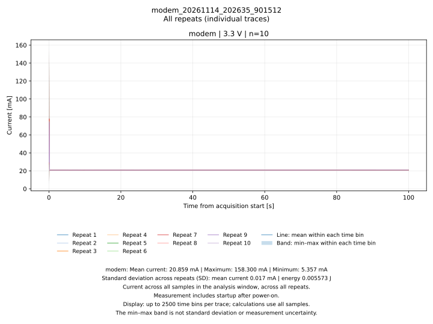
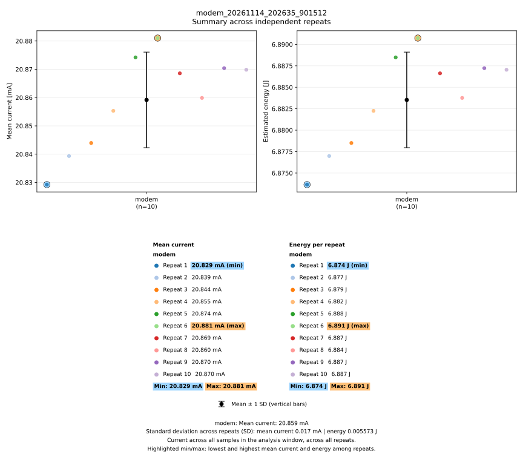
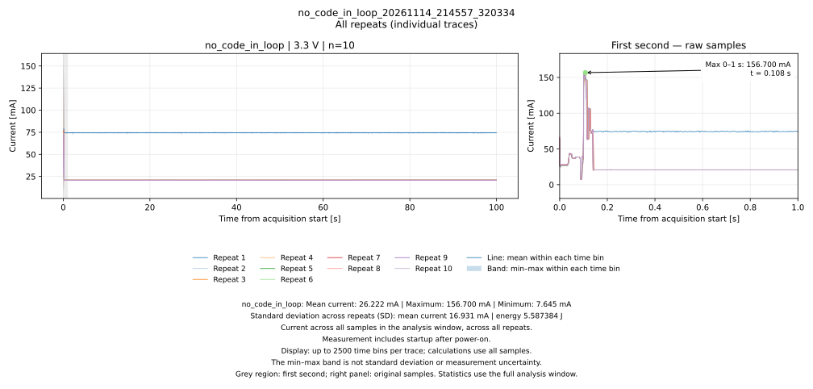
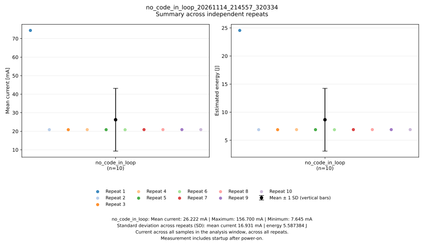
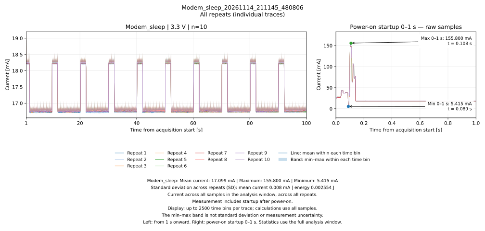
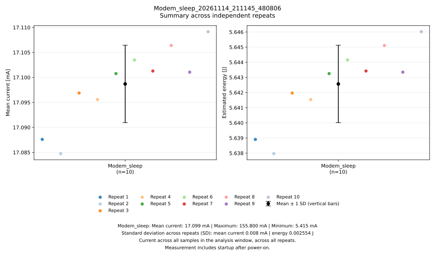

# NodeMCU measurements

Firmware variants and their measurement results. See the main [quick start and methodology](../../README.md) for the measurement setup. Click a plot to open the full-size image.

## 00 — No code

[Sketch](00_no_code/00_no_code.ino): turns off the GPIO2 LED, disables Wi-Fi/radio and serial interfaces, then runs an empty loop. The Arduino runtime remains active; this is not deep sleep.

**Measured: 10 captures × 100 seconds**, at 3.3 V and 1000 Hz, including power-on startup.

### Results

Mean current: **20.859 mA**, SD across captures: **0.017 mA**. Mean estimated energy per capture: **6.884 J**.

| Current traces | Summary statistics |
| --- | --- |
|  |  |

[Raw data and reports](../../results/modem_20261114_202635_901512). The historical session name is `modem`; its notes identify it as “Zero code test”.

Problem with sometimes jump to 80mA

An earlier no-code session, `no_code_in_loop_20261114_214557_320334`, showed an unexpectedly high current of approximately 75–80 mA in capture 1. This was sustained throughout the 100-second capture, rather than being a short startup peak. The remaining nine captures stayed near 21 mA.

Selecting **Tools → Erase Flash → All Flash Contents** in the Arduino IDE and uploading the no-code sketch again resolved the problem in subsequent testing: **20 captures were repeated, and the high-current behavior did not recur, including in capture 1**. These follow-up observations were reported by the operator. Full flash erasure was the successful workaround; the exact cause of the earlier behavior has not been confirmed.

The plots below preserve the original problematic session, before the full flash erase.

| Current traces | Summary statistics |
| --- | --- |
|  |  |

[Raw data and reports](../../results/no_code_in_loop_20261114_214557_320334).

## 01 — Modem sleep

[Sketch](01_modem_cycle/01_modem_cycle.ino): turns the GPIO2 LED on for 2 seconds, then off for approximately 8 seconds using `delay()`. Wi-Fi/radio remains disabled.

**Measured: 10 captures × 100 seconds**, at 3.3 V and 1000 Hz, including power-on startup.

### Results

Mean current: **17.099 mA**, SD across captures: **0.008 mA**. Mean estimated energy per capture: **5.643 J**.

| Current traces | Summary statistics |
| --- | --- |
|  |  |

[Raw data and reports](../../results/Modem_sleep_20261114_211145_480806).

## 02 — Light sleep

[Sketch](02_light_cycle/02_light_cycle.ino): same as scenario 01, but light sleep is used during the 8-second wait. Execution resumes without restarting `setup()`.

**Planned: 10 captures × 100 seconds.**

### Results

**Ongoing.**

## 03 — Deep sleep

[Sketch](03_deep_cycle/03_deep_cycle.ino): same as scenario 01, but deep sleep is used during the 8-second wait. Wakeup requires D0 → RST and restarts `setup()`, adding startup overhead to each cycle.

**Planned: 10 captures × 100 seconds.**

### Results

**Ongoing.**
