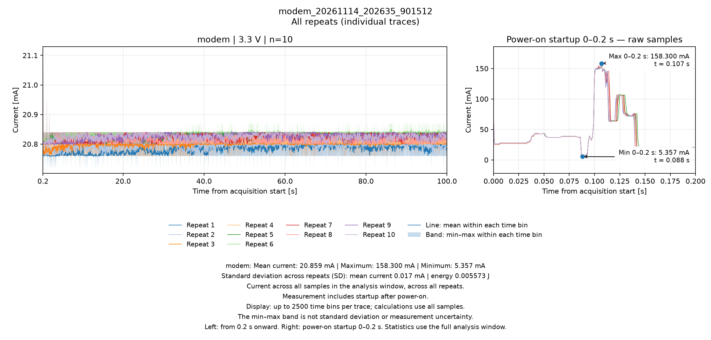
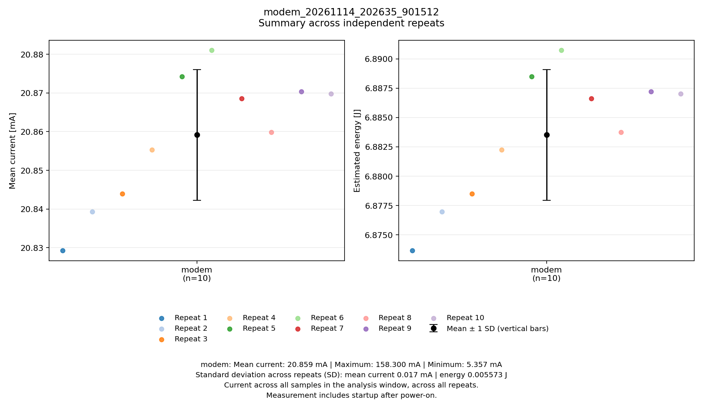

# NodeMCU measurements

Firmware variants and their measurement results. See the main [quick start and methodology](../README.md) for the measurement setup. Click a plot to open the full-size image.

## 00 — No code

[Sketch](00_no_code/00_no_code.ino): turns off the GPIO2 LED, disables Wi-Fi/radio and serial interfaces, then runs an empty loop. The Arduino runtime remains active; this is not deep sleep.

**Measured: 10 captures × 100 seconds**, at 3.3 V and 1000 Hz, including power-on startup.

### Results

Mean current: **20.859 mA**, SD across captures: **0.017 mA**. Mean estimated energy per capture: **6.884 J**.

| Current traces | Summary statistics |
| --- | --- |
|  |  |

[Raw data and reports](../results/modem_20261114_202635_901512). The historical session name is `modem`; its notes identify it as “Zero code test”.

## 01 — Modem sleep

[Sketch](01_modem_cycle/01_modem_cycle.ino): turns the GPIO2 LED on for 2 seconds, then off for approximately 8 seconds using `delay()`. Wi-Fi/radio remains disabled.

**Planned: 10 captures × 100 seconds.**

### Results

**Ongoing.**

## 02 — Light sleep

[Sketch](02_light_cycle/02_light_cycle.ino): turns the GPIO2 LED on for 2 seconds, then requests approximately 8 seconds of light sleep. Execution resumes after wakeup without restarting `setup()`.

**Planned: 10 captures × 100 seconds.**

### Results

**Ongoing.**

## 03 — Deep sleep

[Sketch](03_deep_cycle/03_deep_cycle.ino): turns the GPIO2 LED on for 2 seconds, then enters deep sleep for approximately 8 seconds. Timed wakeup requires D0 → RST and restarts `setup()`, adding startup overhead to each cycle.

**Planned: 10 captures × 100 seconds.**

### Results

**Ongoing.**
