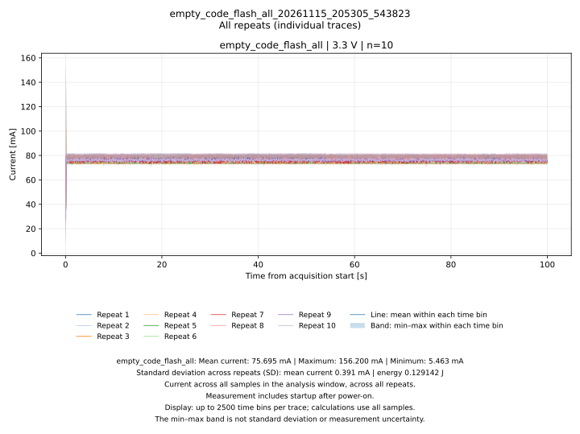
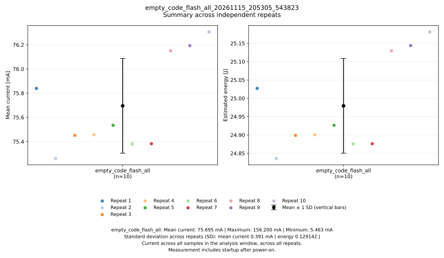
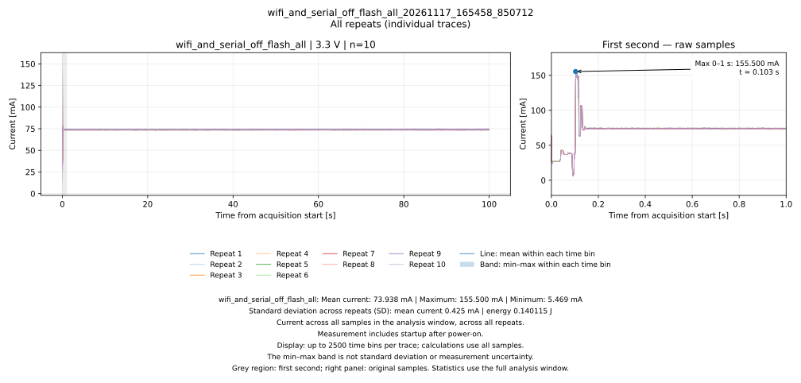

# NodeMCU empty-loop measurements

Six independent sketches to compare initialization choices with an empty `loop()`. Flash one at a time using **NodeMCU 1.0 (ESP-12E Module)**, ESP8266 Arduino Core **3.1.2**, and **80 MHz**. See the main [quick start](../README.md) for measurement instructions.

These variants are independent, not cumulative. Unmentioned peripherals and GPIOs are left at their runtime defaults. Only scenario 06 explicitly turns off the GPIO2 LED. None of these sketches enters CPU deep sleep.

## 01 — Empty

[Sketch](01_empty/01_empty.ino): empty `setup()` and empty `loop()`. The Arduino runtime still executes; this is not CPU sleep.

**Measured: 10 captures × 100 seconds**, at 3.3 V and 1000 Hz, including power-on startup. The sketch was uploaded with **Erase Flash → All Flash Contents** on NodeMCU V3, ESP8266 Core 3.1.2, CPU 80 MHz.

### Results

Mean current: **75.695 mA**, SD across captures: **0.391 mA**. Mean estimated energy per capture: **24.979 J**.

| Current traces | Summary statistics |
| --- | --- |
|  |  |

[Raw data and reports](../results/empty_code_flash_all_20261115_205305_543823). This scenario has no explicit Wi-Fi, radio, UART, or LED shutdown code; it differs from the initialized no-code baseline in [NodeMCU measurements](../nodemcu_led_cycles/README.md#00--no-code).

## 02 — Wi-Fi off

[Sketch](02_wifi_off/02_wifi_off.ino): disable Wi-Fi with `WiFi.mode(WIFI_OFF)` and disable persistent configuration writes. No explicit forced modem sleep or UART changes.

**Measured: 10 captures × 100 seconds**, at 3.3 V and 1000 Hz, including power-on startup. Uploaded with **Erase Flash → All Flash Contents**, ESP8266 Core 3.1.2, CPU 80 MHz.

### Results

Mean current: **73.697 mA**, SD across captures: **0.420 mA**. Mean estimated energy per capture: **24.320 J**.

| Current traces | Summary statistics |
| --- | --- |
|  |  |

[Raw data and reports](../results/wifi_off_flash_all_20261117_154814_125539).

## 03 — Serial off

[Sketch](03_serial_off/03_serial_off.ino): call `Serial.end()` and `Serial1.end()` for ESP8266's two hardware UART interfaces. No explicit Wi-Fi, radio, or LED changes; boot-ROM serial output occurs before `setup()` and is unaffected.

**Measured: 10 captures × 100 seconds**, at 3.3 V and 1000 Hz, including power-on startup. Uploaded with **Erase Flash → All Flash Contents**, ESP8266 Core 3.1.2, CPU 80 MHz.

### Results

Mean current: **73.702 mA**, SD across captures: **0.376 mA**. Mean estimated energy per capture: **24.322 J**.

| Current traces | Summary statistics |
| --- | --- |
|  |  |

[Raw data and reports](../results/serial_off_flash_all_20261117_161237_936001).

## 04 — Wi-Fi and Serial off

[Sketch](04_wifi_and_serial_off/04_wifi_and_serial_off.ino): disable Wi-Fi and persistent configuration writes, then call `Serial.end()` and `Serial1.end()`. No `RF_MODE(RF_DISABLED)`, forced modem sleep, or LED configuration is used; `loop()` remains empty.

**Measured: 10 captures × 100 seconds**, at 3.3 V and 1000 Hz, including power-on startup. Uploaded with **Erase Flash → All Flash Contents**, ESP8266 Core 3.1.2, CPU 80 MHz.

### Results

Mean current: **73.938 mA**, SD across captures: **0.425 mA**. Mean estimated energy per capture: **24.400 J**.

| Current traces | Summary statistics |
| --- | --- |
|  |  |

[Raw data and reports](../results/wifi_and_serial_off_flash_all_20261117_165458_850712).

## 05 — RF disabled

[Sketch](05_RF_disabled/05_RF_disabled.ino): select `RF_MODE(RF_DISABLED)` before SDK RF initialization, with empty `setup()` and `loop()`. No explicit UART or LED changes are made; this variant tests the startup RF option rather than calling `WiFi.forceSleepBegin()` after startup.

References: [RF mode definitions](https://github.com/esp8266/Arduino/blob/3.1.2/cores/esp8266/Esp.h#L44) and [pre-initialization hook](https://github.com/esp8266/Arduino/blob/3.1.2/cores/esp8266/core_esp8266_phy.cpp). Verify behavior on the selected Core/SDK with a measurement.

**Results: Ongoing.**

## 06 — Combined shutdown and forced modem sleep

[Sketch](06_Combine_WifiDeepSleep/06_Combine_WifiDeepSleep.ino): select `RF_MODE(RF_DISABLED)` before SDK RF initialization, then disable Wi-Fi, request modem sleep, end both UART interfaces, and turn off the GPIO2 / D4 LED after releasing UART1. `WiFi.forceSleepBegin()` requests radio/modem sleep, not CPU deep sleep; the Arduino runtime continues to execute.

**Results: Ongoing.**

## Recording

Use a distinct `--name` for each sketch, such as `empty_code_flash_all`, `wifi_off_flash_all`, `serial_off_flash_all`, `wifi_and_serial_off_flash_all`, `rf_disabled_flash_all`, and `combined_off_flash_all`. Record the actual sketch, board, Core version, clock, erase-flash option, and wiring in `--notes`. Keep all other measurement conditions identical.

Results are available for scenarios 01–04. Measurements for scenarios 05–06 are ongoing.
