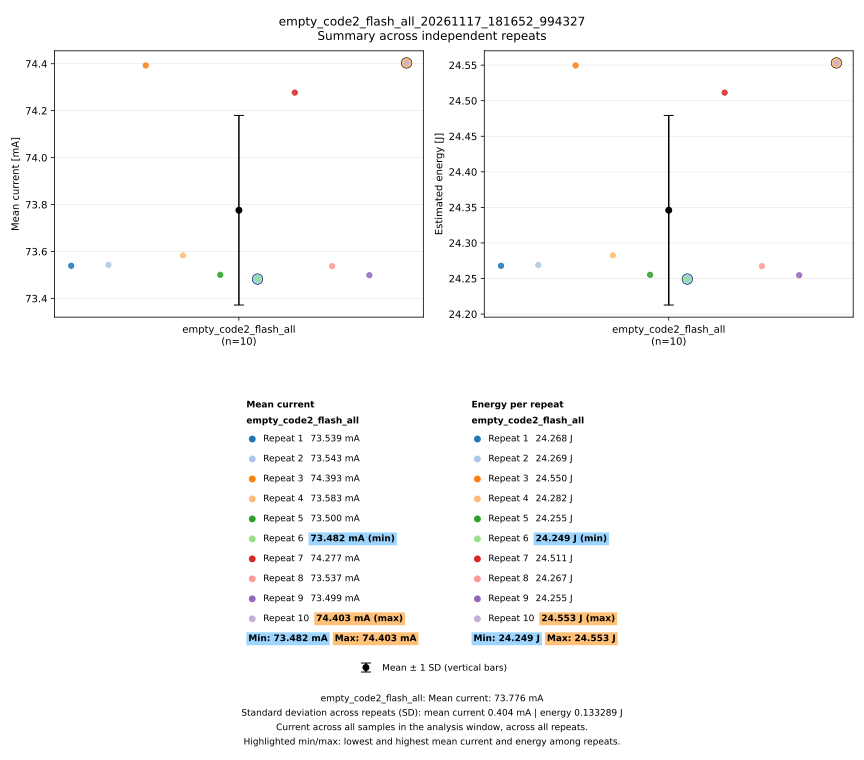
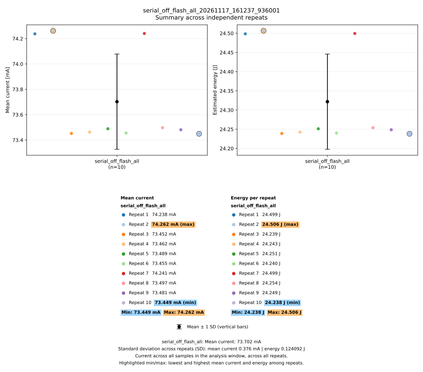
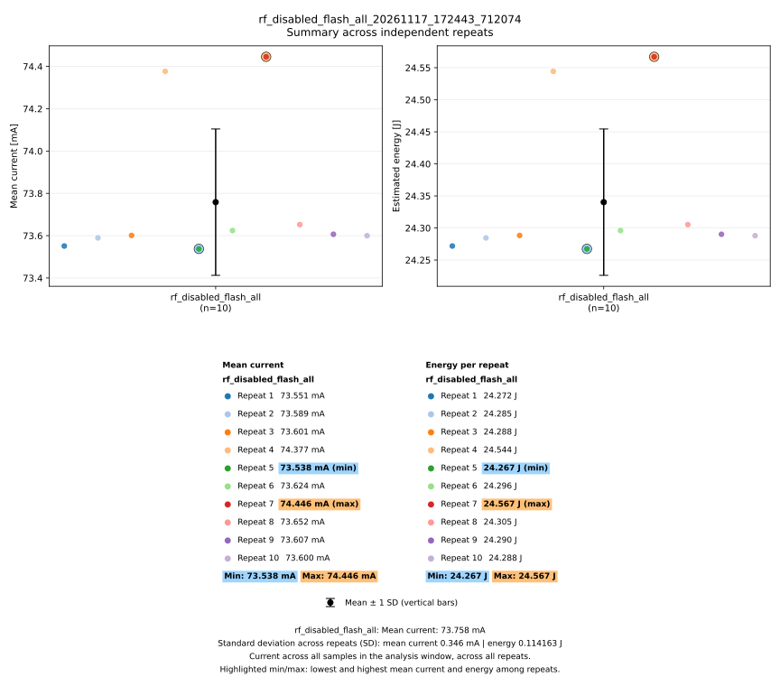
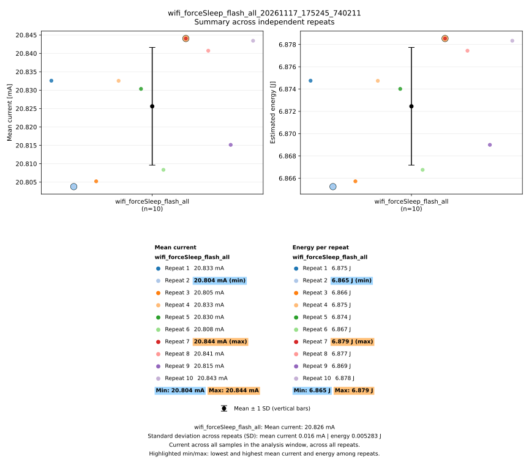
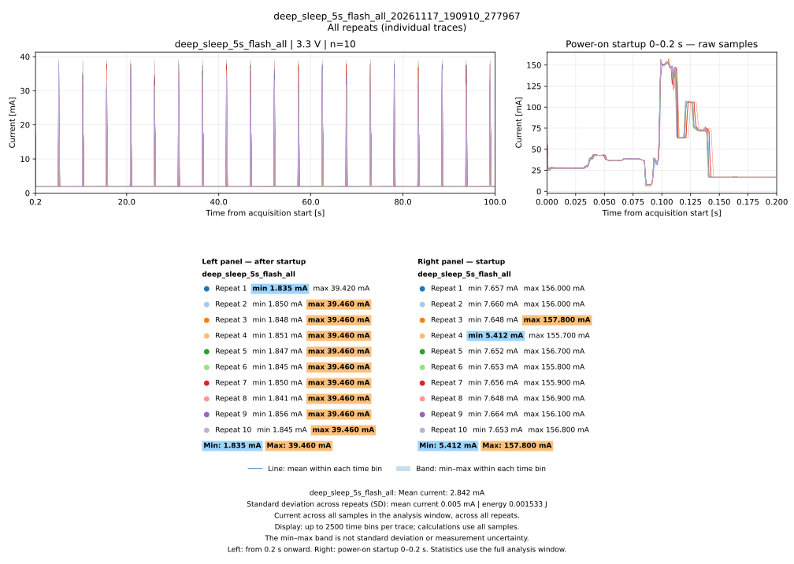
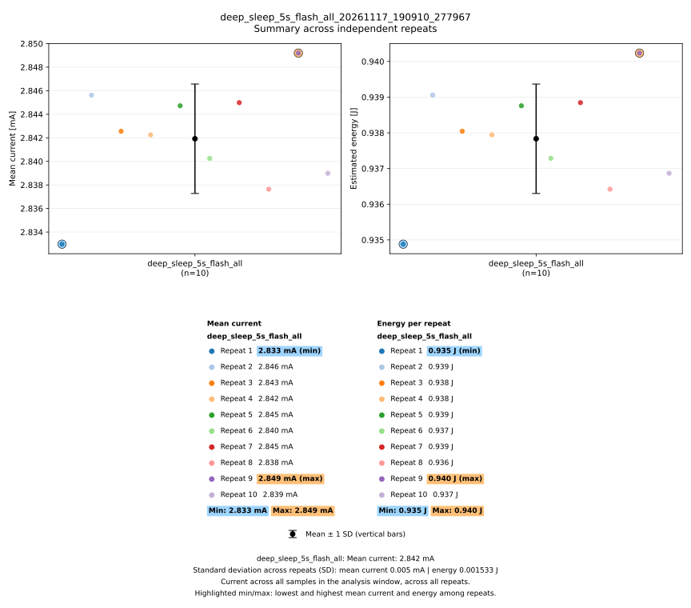
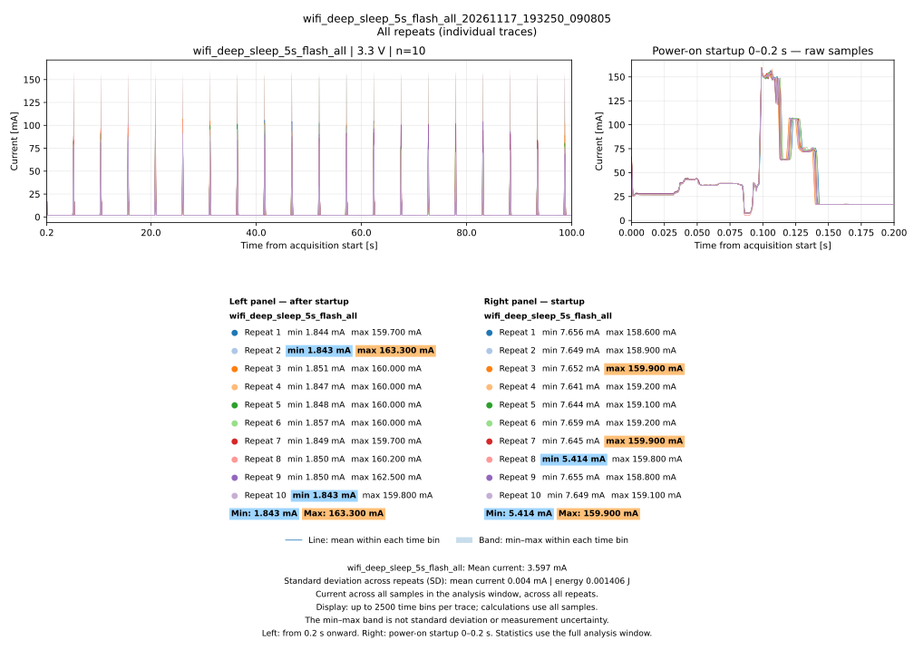
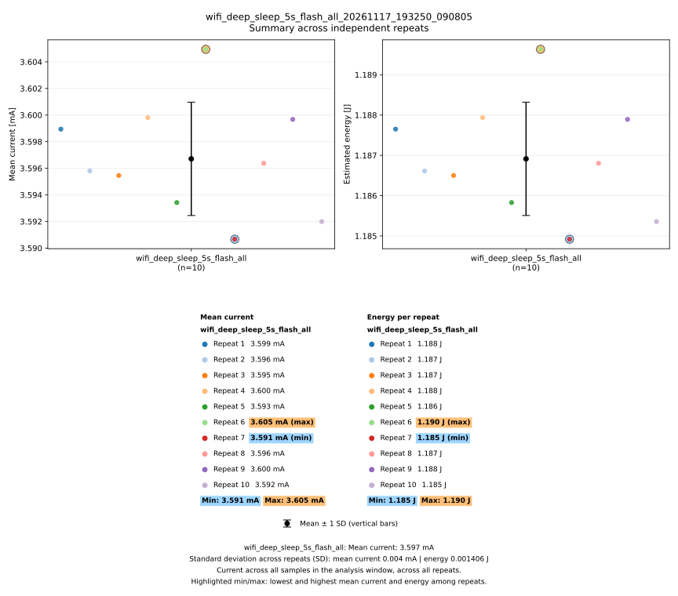
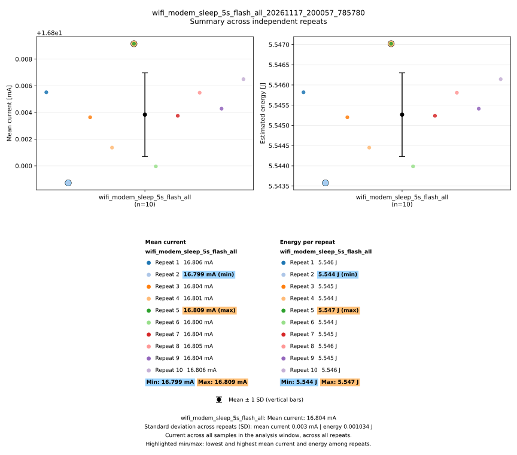

# NodeMCU idle-current measurements

Platform: **NodeMCU V3**, Arduino board **NodeMCU 1.0 (ESP-12E Module)**, **ESP8266 Core 3.1.2**, **80 MHz**; upload with **Erase All Flash** (**Erase Flash → All Flash Contents**). Each scenario uses **10 × 100 s** captures at **3.3 V**, **1000 Hz**, including power-on startup; variants are independent, with no explicit LED configuration or access-point connection. Scenarios 01–06 use an empty `loop()`, 07 and 10 use a five-second loop delay, and 08–09 enter deep sleep from `setup()`; measurement commands are in the [quick start](../README.md).

| Scenario | Key API / Config | Mean Current [mA] | SD [mA] | Energy / 100s [J] |
| --- | --- | ---: | ---: | ---: |
| [01 — Empty](01_empty/01_empty.ino) | `Empty setup() / loop()` | 73.776 | 0.404 | 24.346 |
| [02 — Wi-Fi off](02_wifi_off/02_wifi_off.ino) | `WiFi.mode(WIFI_OFF)` | 73.697 | 0.420 | 24.320 |
| [03 — Serial off](03_serial_off/03_serial_off.ino) | `Serial.end(); Serial1.end()` | 73.702 | 0.376 | 24.322 |
| [04 — Wi-Fi and Serial off](04_wifi_and_serial_off/04_wifi_and_serial_off.ino) | `WIFI_OFF + both UARTs off` | 73.938 | 0.425 | 24.400 |
| [05 — RF disabled](05_RF_disabled/05_RF_disabled.ino) | `RF_MODE(RF_DISABLED)` | 73.758 | 0.346 | 24.340 |
| [06 — Wi-Fi forced sleep](06_WifiForceSleep/06_WifiForceSleep.ino) | `WiFi.forceSleepBegin(); delay(1)` | 20.826 | 0.016 | 6.872 |
| [07 — Five-second delay in loop](07_delay_5s_in_loop/07_delay_5s_in_loop.ino) | `delay(5000)` | 16.777 | 0.007 | 5.536 |
| [08 — Five-second deep sleep from setup](08_deep_sleep_5s_setup/08_deep_sleep_5s_setup.ino) | `ESP.deepSleep(5e6, WAKE_RF_DISABLED)` | 2.842 | 0.005 | 0.938 |
| [09 — Five-second deep sleep with default RF wakeup](09_deep_sleep_5s_Radio_on/09_deep_sleep_5s_Radio_on.ino) | `ESP.deepSleep(5e6)` | 3.597 | 0.004 | 1.187 |
| [10 — Automatic modem sleep with a five-second delay](10_modem_sleep_5s/10_modem_sleep_5s.ino) | `WiFi.setSleepMode(WIFI_MODEM_SLEEP); delay(5000)` | 16.804 | 0.003 | 5.545 |

Mean current and energy are averages across captures. SD is the sample standard deviation of capture mean currents; energy is estimated per 100 s capture.

## 01 — Empty

[Sketch](01_empty/01_empty.ino). Empty `setup()` and `loop()`. Arduino runtime remains active.

| Current traces | Summary statistics |
| --- | --- |
|  |  |

[Raw data and reports](../results/empty_code2_flash_all_20261117_181652_994327).

## 02 — Wi-Fi off

[Sketch](02_wifi_off/02_wifi_off.ino). Calls `WiFi.persistent(false)` and `WiFi.mode(WIFI_OFF)`.

| Current traces | Summary statistics |
| --- | --- |
|  |  |

[Raw data and reports](../results/wifi_off_flash_all_20261117_154814_125539).

## 03 — Serial off

[Sketch](03_serial_off/03_serial_off.ino). Calls `Serial.end()` and `Serial1.end()`. Boot-ROM output precedes `setup()` and is unaffected.

| Current traces | Summary statistics |
| --- | --- |
|  |  |

[Raw data and reports](../results/serial_off_flash_all_20261117_161237_936001).

## 04 — Wi-Fi and Serial off

[Sketch](04_wifi_and_serial_off/04_wifi_and_serial_off.ino). Combines scenario 02 with `Serial.end()` and `Serial1.end()`.

| Current traces | Summary statistics |
| --- | --- |
|  |  |

[Raw data and reports](../results/wifi_and_serial_off_flash_all_20261117_165458_850712).

## 05 — RF disabled

[Sketch](05_RF_disabled/05_RF_disabled.ino). Selects `RF_MODE(RF_DISABLED)` before SDK RF initialization; `setup()` and `loop()` are empty.

| Current traces | Summary statistics |
| --- | --- |
|  |  |

[Raw data and reports](../results/rf_disabled_flash_all_20261117_172443_712074).

## 06 — Wi-Fi forced sleep

[Sketch](06_WifiForceSleep/06_WifiForceSleep.ino). Calls `WiFi.forceSleepBegin()` and `delay(1)` in `setup()`. CPU continues through an empty `loop()`.

| Current traces | Summary statistics |
| --- | --- |
|  |  |

[Raw data and reports](../results/wifi_forceSleep_flash_all_20261117_175245_740211).

## 07 — Five-second delay in loop

[Sketch](07_delay_5s_in_loop/07_delay_5s_in_loop.ino). Empty `setup()`; `delay(5000)` on every loop iteration.

| Current traces | Summary statistics |
| --- | --- |
|  |  |

[Raw data and reports](../results/delay_loop_5s_flash_all_20261117_184108_287151).

## 08 — Five-second deep sleep from setup

[Sketch](08_deep_sleep_5s_setup/08_deep_sleep_5s_setup.ino). Calls `ESP.deepSleep(5e6, WAKE_RF_DISABLED)` in `setup()`: five-second sleep, restart with RF disabled, then sleep again. Timed wakeup requires **D0 / GPIO16 → RST**.

| Current traces | Summary statistics |
| --- | --- |
|  |  |

[Raw data and reports](../results/deep_sleep_5s_flash_all_20261117_190910_277967).

## 09 — Five-second deep sleep with default RF wakeup

[Sketch](09_deep_sleep_5s_Radio_on/09_deep_sleep_5s_Radio_on.ino). Same cycle as 08, using `ESP.deepSleep(5e6)` with `RF_DEFAULT`. RF initialization on wakeup follows SDK configuration; radio remains off during deep sleep. Timed wakeup requires **D0 / GPIO16 → RST**.

| Current traces | Summary statistics |
| --- | --- |
|  |  |

[Raw data and reports](../results/wifi_deep_sleep_5s_flash_all_20261117_193250_090805).

## 10 — Automatic modem sleep with a five-second delay

[Sketch](10_modem_sleep_5s/10_modem_sleep_5s.ino). Calls `WiFi.setSleepMode(WIFI_MODEM_SLEEP)` in `setup()` and `delay(5000)` in `loop()`. No access-point connection; five seconds is the loop delay, not a fixed radio-sleep interval.

| Current traces | Summary statistics |
| --- | --- |
|  |  |

[Raw data and reports](../results/wifi_modem_sleep_5s_flash_all_20261117_200057_785780).

## Lab notes

- Baseline: scenario 01 uses an empty sketch; the initialized baseline is documented separately in [NodeMCU measurements](../nodemcu_led_cycles/README.md#00--no-code).
- Rejected baseline: [empty_code_flash_all_20261115_205305_543823](../results/empty_code_flash_all_20261115_205305_543823) — [Current traces](../results/empty_code_flash_all_20261115_205305_543823/comparison_eng.svg) · [Summary statistics](../results/empty_code_flash_all_20261115_205305_543823/statistics_eng.svg). Larger fluctuations were not reproduced in the replacement session. Cause unconfirmed; original data retained for comparison.
- Use a distinct `--name` per sketch. Record sketch, board, Core version, clock, flash-erasure setting and wiring in `--notes`; keep other conditions fixed.

## References

- [RF mode definitions and default deepSleep argument](https://github.com/esp8266/Arduino/blob/3.1.2/cores/esp8266/Esp.h#L44); [pre-initialization hook](https://github.com/esp8266/Arduino/blob/3.1.2/cores/esp8266/core_esp8266_phy.cpp).
- [Automatic modem sleep and DTIM](https://arduino-esp8266.readthedocs.io/en/3.1.2/esp8266wifi/generic-class.html#wi-fi-power-management-dtim).
