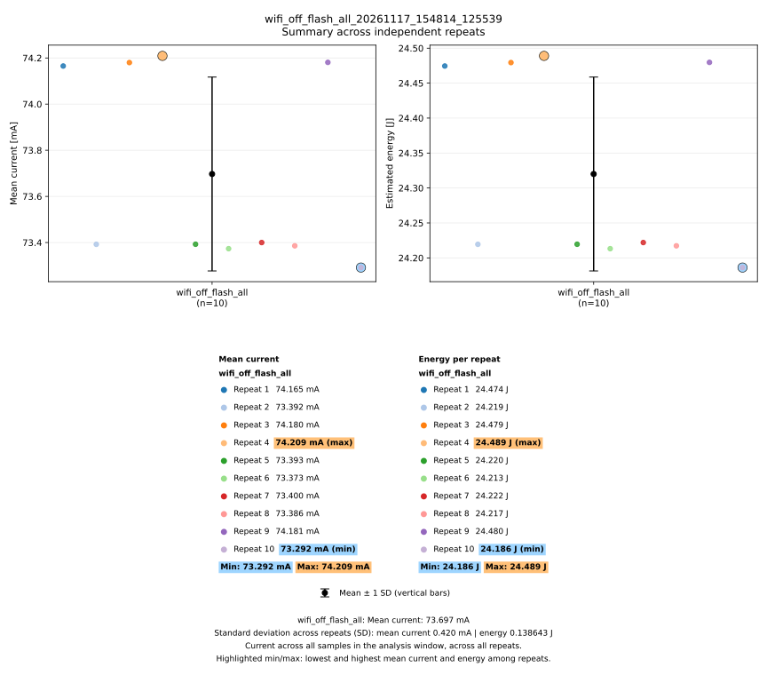
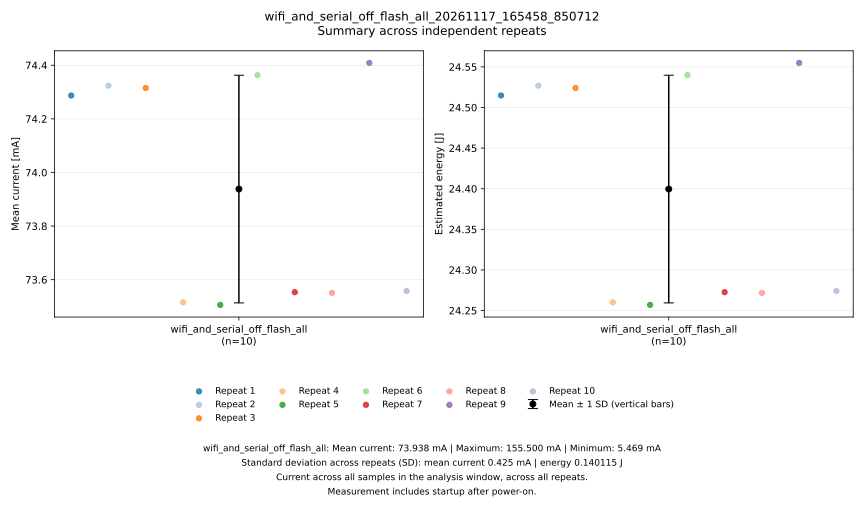
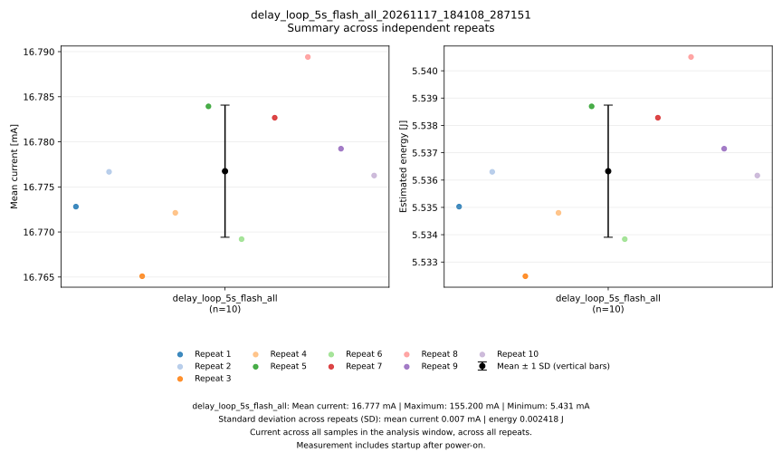

# NodeMCU empty-loop measurements

Nine independent sketches to compare initialization choices and idle behavior. Flash one at a time using **NodeMCU 1.0 (ESP-12E Module)**, ESP8266 Arduino Core **3.1.2**, and **80 MHz**. See the main [quick start](../README.md) for measurement instructions.

These variants are independent, not cumulative. Unmentioned peripherals and GPIOs are left at their runtime defaults. None of these sketches explicitly configures the LED. Scenarios 01–06 have an empty `loop()`; scenario 07 waits five seconds on each iteration; scenarios 08–09 enter CPU deep sleep from `setup()`.

## 01 — Empty

[Sketch](01_empty/01_empty.ino): empty `setup()` and empty `loop()`. The Arduino runtime still executes; this is not CPU sleep.

**Measured: 10 captures × 100 seconds**, at 3.3 V and 1000 Hz, including power-on startup. The sketch was uploaded with **Erase Flash → All Flash Contents** on NodeMCU V3, ESP8266 Core 3.1.2, CPU 80 MHz.

### Results

Mean current: **73.776 mA**, SD across captures: **0.404 mA**. Mean estimated energy per capture: **24.346 J**.

| Current traces | Summary statistics |
| --- | --- |
|  |  |

[Raw data and reports](../results/empty_code2_flash_all_20261117_181652_994327). This scenario has no explicit Wi-Fi, radio, UART, or LED shutdown code; it differs from the initialized no-code baseline in [NodeMCU measurements](../nodemcu_led_cycles/README.md#00--no-code).

The earlier session `empty_code_flash_all_20261115_205305_543823` was rejected as the baseline because its larger fluctuations were not reproduced in the repeat session. Its cause remains unconfirmed; the original data are retained locally.

## 02 — Wi-Fi off

[Sketch](02_wifi_off/02_wifi_off.ino): disable Wi-Fi with `WiFi.mode(WIFI_OFF)` and disable persistent configuration writes. No explicit forced modem sleep or UART changes.

**Measured: 10 captures × 100 seconds**, at 3.3 V and 1000 Hz, including power-on startup. Uploaded with **Erase Flash → All Flash Contents**, ESP8266 Core 3.1.2, CPU 80 MHz.

### Results

Mean current: **73.697 mA**, SD across captures: **0.420 mA**. Mean estimated energy per capture: **24.320 J**.

| Current traces | Summary statistics |
| --- | --- |
|  |  |

[Raw data and reports](../results/wifi_off_flash_all_20261117_154814_125539).

## 03 — Serial off

[Sketch](03_serial_off/03_serial_off.ino): call `Serial.end()` and `Serial1.end()` for ESP8266's two hardware UART interfaces. No explicit Wi-Fi, radio, or LED changes; boot-ROM serial output occurs before `setup()` and is unaffected.

**Measured: 10 captures × 100 seconds**, at 3.3 V and 1000 Hz, including power-on startup. Uploaded with **Erase Flash → All Flash Contents**, ESP8266 Core 3.1.2, CPU 80 MHz.

### Results

Mean current: **73.702 mA**, SD across captures: **0.376 mA**. Mean estimated energy per capture: **24.322 J**.

| Current traces | Summary statistics |
| --- | --- |
|  |  |

[Raw data and reports](../results/serial_off_flash_all_20261117_161237_936001).

## 04 — Wi-Fi and Serial off

[Sketch](04_wifi_and_serial_off/04_wifi_and_serial_off.ino): disable Wi-Fi and persistent configuration writes, then call `Serial.end()` and `Serial1.end()`. No `RF_MODE(RF_DISABLED)`, forced modem sleep, or LED configuration is used; `loop()` remains empty.

**Measured: 10 captures × 100 seconds**, at 3.3 V and 1000 Hz, including power-on startup. Uploaded with **Erase Flash → All Flash Contents**, ESP8266 Core 3.1.2, CPU 80 MHz.

### Results

Mean current: **73.938 mA**, SD across captures: **0.425 mA**. Mean estimated energy per capture: **24.400 J**.

| Current traces | Summary statistics |
| --- | --- |
|  |  |

[Raw data and reports](../results/wifi_and_serial_off_flash_all_20261117_165458_850712).

## 05 — RF disabled

[Sketch](05_RF_disabled/05_RF_disabled.ino): select `RF_MODE(RF_DISABLED)` before SDK RF initialization, with empty `setup()` and `loop()`. No explicit UART or LED changes are made; this variant tests the startup RF option rather than calling `WiFi.forceSleepBegin()` after startup.

References: [RF mode definitions](https://github.com/esp8266/Arduino/blob/3.1.2/cores/esp8266/Esp.h#L44) and [pre-initialization hook](https://github.com/esp8266/Arduino/blob/3.1.2/cores/esp8266/core_esp8266_phy.cpp). Verify behavior on the selected Core/SDK with a measurement.

**Measured: 10 captures × 100 seconds**, at 3.3 V and 1000 Hz, including power-on startup. Uploaded with **Erase Flash → All Flash Contents**, ESP8266 Core 3.1.2, CPU 80 MHz.

### Results

Mean current: **73.758 mA**, SD across captures: **0.346 mA**. Mean estimated energy per capture: **24.340 J**.

| Current traces | Summary statistics |
| --- | --- |
|  |  |

[Raw data and reports](../results/rf_disabled_flash_all_20261117_172443_712074).

## 06 — Wi-Fi forced sleep

[Sketch](06_WifiForceSleep/06_WifiForceSleep.ino): call `WiFi.forceSleepBegin()` followed by `delay(1)` in `setup()`, then run an empty `loop()`. This requests radio/modem sleep, not CPU deep sleep; there are no explicit UART or LED changes.

**Results: Ongoing.**

## 07 — Five-second delay in loop

[Sketch](07_delay_5s_in_loop/07_delay_5s_in_loop.ino): empty `setup()` with `delay(5000)` on each iteration of `loop()`. No explicit Wi-Fi, RF, UART, or LED changes. This tests yielding during idle time; a current reduction depends on the runtime and power-management state and must be measured.

**Measured: 10 captures × 100 seconds**, at 3.3 V and 1000 Hz, including power-on startup. Uploaded with **Erase Flash → All Flash Contents**, ESP8266 Core 3.1.2, CPU 80 MHz.

### Results

Mean current: **16.777 mA**, SD across captures: **0.007 mA**. Mean estimated energy per capture: **5.536 J**.

| Current traces | Summary statistics |
| --- | --- |
|  |  |

[Raw data and reports](../results/delay_loop_5s_flash_all_20261117_184108_287151).

## 08 — Five-second deep sleep from setup

[Sketch](08_deep_sleep_5s_setup/08_deep_sleep_5s_setup.ino): call `ESP.deepSleep(5e6, WAKE_RF_DISABLED)` immediately from `setup()`. The ESP8266 sleeps for approximately five seconds and restarts on wakeup with RF disabled; each cycle includes boot overhead before re-entering sleep. Connect **D0 / GPIO16 to RST** for timed wakeup and record this wiring in the measurement notes.

**Results: Ongoing.**

## 09 — Five-second deep sleep with default RF wakeup

[Sketch](09_deep_sleep_5s_Radio_on/09_deep_sleep_5s_Radio_on.ino): same as scenario 08, but call `ESP.deepSleep(5e6)` without an explicit RF option. This uses `RF_DEFAULT`, whose RF calibration behavior on wakeup depends on SDK initialization data. The folder name refers to allowing default RF startup after wakeup; the radio is off during deep sleep, and no Wi-Fi connection is configured. Connect **D0 / GPIO16 to RST** for timed wakeup.

Reference: [Core 3.1.2 RF options and default deepSleep argument](https://github.com/esp8266/Arduino/blob/3.1.2/cores/esp8266/Esp.h#L44).

**Results: Ongoing.**

## Recording

Use a distinct `--name` for each sketch, such as `empty_code_flash_all`, `wifi_off_flash_all`, `serial_off_flash_all`, `wifi_and_serial_off_flash_all`, `rf_disabled_flash_all`, `wifi_force_sleep_flash_all`, `delay_loop_5s_flash_all`, `deep_sleep_5s_flash_all`, and `deep_sleep_5s_rf_default_flash_all`. Record the actual sketch, board, Core version, clock, erase-flash option, and wiring in `--notes`. Keep all other measurement conditions identical.

Results are available for scenarios 01–05 and 07. Measurements for scenarios 06 and 08–09 are ongoing.
